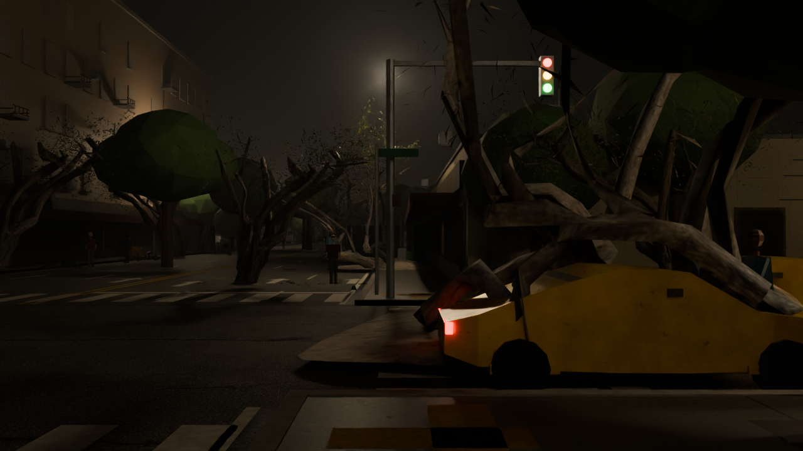
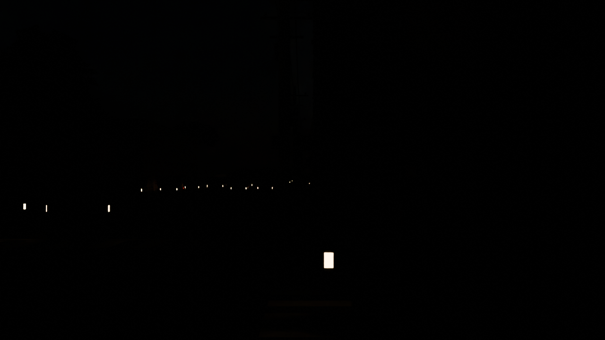
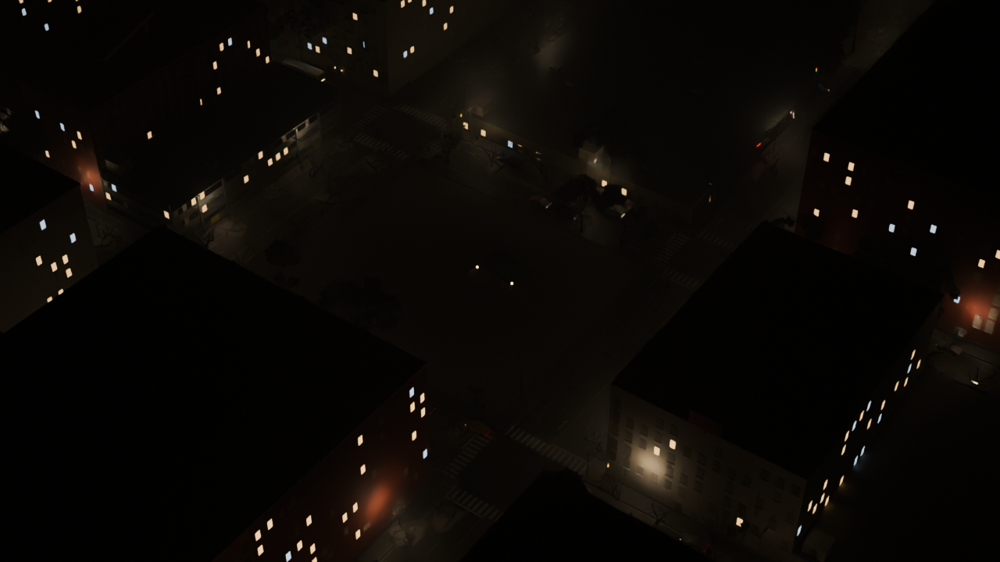

# START HERE — reviewing the work

One page. Three ways to check it, shortest first.

---

## 1. Look at the pictures (30 seconds, nothing to install)

These render straight on the GitHub page — just scroll.





If those look like a city, the build works. That is the whole test.

*(Measured on a 2-core box: clone 20 s, Blender setup from the vendored copy,
build 39 s, 20 modules, no failures. The clone is ~860 MB because Blender and
all the scanned assets are committed, so nothing has to be downloaded later.)*

---

## 2. Open the city yourself (one command)

```bash
bash tools/setup_env.sh && source tools/env.sh                  # installs Blender, offline
blender -b -P master.py -- --size 300 --no-render --out build   # writes build/city.blend
```

Then open `build/city.blend` in Blender. Nothing else to configure — textures
are packed into the file, so it opens standalone on any machine.

Without `--out build` the file lands in the repo root instead; the flag just
keeps generated output out of the way.

Blender is vendored in `vendor/blender/` inside this repo, so step one needs no
network and no admin rights.

---

## 3. Read the code (ordered by what matters)

| Read this | To understand |
|---|---|
| `master.py` | the whole pipeline in one list — 21 modules, in build order |
| `core.py` | config, seeded RNG, materials, the masterplan solver |
| `README.md` | every CLI flag, module map, measured scale table |
| `COLLAB.md` | who built what, and the rules we work under |

Each module also runs standalone, e.g. `blender -b -P trees.py`, so you can
inspect one piece without building the whole city.

---

## What is actually in there

Built across several agents working on `main`:

| Area | Module | State |
|---|---|---|
| Ground, roads, sidewalks, river, highway | `terrain` `roads` `sidewalks` | original |
| Buildings, facades, roofs, damage | `buildings_*` `facade_detail` `roofs` `damage` | original + fixes |
| **People** | `people.py` | proportioned figures, 5 poses, scattered by district |
| **Real trees** | `trees.py` | branching structures, not spheres on sticks |
| **Traffic** | `traffic.py` | lane discipline and queueing at lights |
| **Signage** | `signage.py` | readable type, not coloured slabs |
| **Animals** | `animals.py` | pigeons, gulls, crows, dogs, cats, rats |
| **LA look** | `la_style.py` | palms, mountain backdrop, strip malls |
| **Scanned props** | `assets_models.py` | 22 CC0 photoscans, decimated to budget |
| **Photographic materials** | `assets_pbr.py` | 14 PBR sets + HDRI sky |
| **Blender UI panel** | `city_addon.py` | build and re-roll from the N-panel |

Honest gaps are listed in `master.py` under `SELF-CRITIQUE`, and the open ones
are tracked in `agents/board.json`. Nothing is hidden.

---

## Is anything at risk of being lost?

No. Three copies, and the important one is off-machine:

- **GitHub** — `github.com/bigboyz10/lalacitybuild`, pushed automatically
- **Local mirror** — outside the workspace, survives a workspace wipe
- **The workspace** — what you are looking at

The sandbox has reset several times during this project, destroying Blender,
the mirror and the credentials each time. Every recovery came back from GitHub.
Details and the two post-reset commands are in `RECOVERY.md`.
